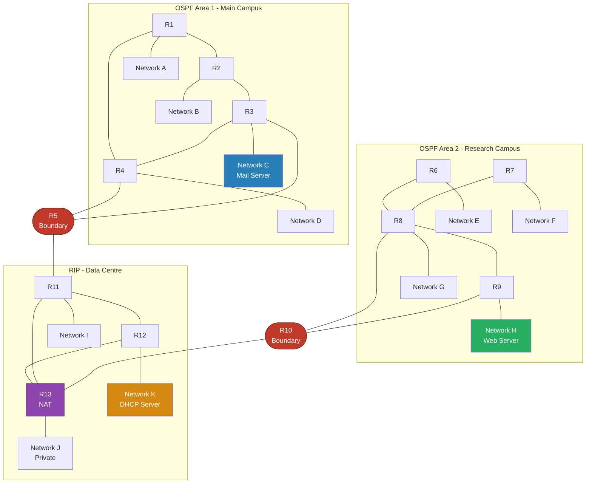
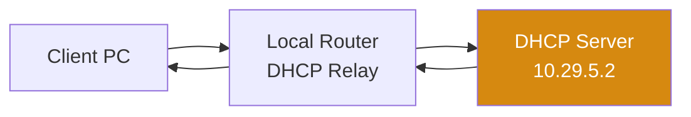
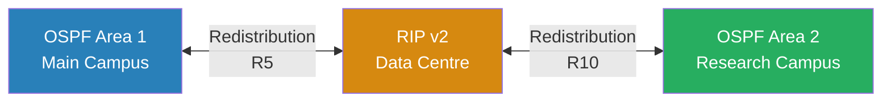

<div align="center">


<a href="https://github.com/AbdulAzeemHashmi/enterprise-network-infrastructure">
  
</a>

<br/>


</div>

---

## Table of Contents

- [About the Project](#about-the-project)
- [Repository Structure](#repository-structure)
- [Network Topology](#network-topology)
- [IP Addressing and VLSM](#ip-addressing-and-vlsm)
- [Routing Design](#routing-design)
- [Services and Security](#services-and-security)
- [Test Results](#test-results)
- [Known Limitations](#known-limitations)
- [How to Run the Project](#how-to-run-the-project)
- [Skills Demonstrated](#skills-demonstrated)
- [Author](#author)

---

## About the Project

Horizon University grew from one building into a group of campuses. Its network was built in stages, so it needed to be joined into one working network.

This project is the **Computer Networks Lab Project (Fall 2026)**. The goal is to plan the addressing, give each block its own routing method, and make all networks reach each other. Everything is built and tested in **Cisco Packet Tracer**.

| Block | Routing Method | What it hosts |
|:------|:---------------|:--------------|
| Main Campus | OSPF Area 1 | Mail server (Network C), Networks A, B, C, D |
| Research Campus | OSPF Area 2 | Web server (Network H), Networks E, F, G, H |
| Data Centre | RIP version 2 | DHCP server (Network K), Networks I, J, K, and NAT on R13 |

Two boundary routers connect the blocks and share routes between them using redistribution.

### Main Goals

| No. | Task | Status |
|:---:|:-----|:-------|
| 1 | Build the layout and use the assigned address block | Done |
| 2 | Use VLSM for every network | Done |
| 3 | Use OSPF Area 1, OSPF Area 2, and RIP | Done |
| 4 | Redistribution on routers that join two blocks | Done |
| 5 | Central DHCP server in Network K | Done |
| 6 | NAT on R13 for Network J | Done |
| 7 | ACLs to block access to the web server | Configured |
| 8 | Email for Networks A, B, C, D | Done |

---

## Repository Structure

```text
enterprise-network-infrastructure/
|
|-- README.md
|-- 24I-2013_Abdul_Azeem_Hashmi.pkt
|-- 24I-2013_Abdul_Azeem_Hashmi_Report.pdf
|-- Problem Statement.pdf
```

| File | Description |
|:-----|:------------|
| [`24I-2013_Abdul_Azeem_Hashmi.pkt`](./24I-2013_Abdul_Azeem_Hashmi.pkt) | The Cisco Packet Tracer project file with the full network |
| [`24I-2013_Abdul_Azeem_Hashmi_Report.pdf`](./24I-2013_Abdul_Azeem_Hashmi_Report.pdf) | Project report with explanation and screenshot evidence |
| [`Problem Statement.pdf`](./Problem%20Statement.pdf) | The original lab project task from the instructor |

---

## Network Topology

The diagram below shows the logical design. Routers in red are the boundary routers (R5 and R10) that join two different blocks.



> The exact router names in the `.pkt` file (for example Router7, Router10, Router19, Router20) are the Packet Tracer device names. Router7 is R1, Router10 is R4, Router19 is R5, Router20 is R10, and Router13 is R13.

### Data Flow Idea



---

## IP Addressing and VLSM

| Item | Value |
|:-----|:------|
| Main IP block | `10.29.0.0/16` |
| Private IP block (NAT, Network J) | `192.168.173.0/24` |
| Router to router links | `/30` subnets (4 addresses per link) |

### LAN Addressing Plan

| Network | Network Address | Subnet Mask | Default Gateway |
|:-------:|:----------------|:------------|:----------------|
| A | `10.29.0.0/24` | `255.255.255.0` | `10.29.0.1` |
| C | `10.29.1.0/24` | `255.255.255.0` | `10.29.1.1` |
| F | `10.29.2.0/24` | `255.255.255.0` | `10.29.2.1` |
| G | `10.29.3.0/24` | `255.255.255.0` | `10.29.3.1` |
| I | `10.29.4.0/24` | `255.255.255.0` | `10.29.4.1` |
| K | `10.29.5.0/24` | `255.255.255.0` | `10.29.5.1` |
| H | `10.29.6.0/25` | `255.255.255.128` | `10.29.6.1` |
| E | `10.29.6.128/26` | `255.255.255.192` | `10.29.6.129` |
| B | `10.29.6.192/27` | `255.255.255.224` | `10.29.6.193` |
| D | `10.29.6.224/27` | `255.255.255.224` | `10.29.6.225` |
| J (private) | `192.168.173.0/25` | `255.255.255.128` | `192.168.173.1` |

The point to point links between routers use the `10.29.7.0` range, each as a `/30`.

---

## Routing Design



| Block | Protocol | Notes |
|:------|:---------|:------|
| Main Campus | OSPF, Area 1 | Neighbors reach the FULL state |
| Research Campus | OSPF, Area 2 | Neighbors reach the FULL state |
| Data Centre | RIP version 2 | Auto summary turned off |
| R5 and R10 | OSPF and RIP | Routes are redistributed in both directions |

Useful commands used for checking:

```text
show ip ospf neighbor
show ip route
show ip protocols
show running-config
```

---

## Services and Security

<table>
<tr>
<td width="50%" valign="top">

### DHCP

- Central DHCP server in **Network K** at `10.29.5.2`
- Pools created for networks A, B, C, D, I, J, K
- Routers use `ip helper-address 10.29.5.2` as a relay
- Clients in other networks get addresses from the central server

</td>
<td width="50%" valign="top">

### NAT (PAT)

- Done on **R13** for Network J
- Inside interface: LAN `192.168.173.1`
- Outside interfaces: the router links
- Overload mode, so many hosts share one address

</td>
</tr>
<tr>
<td width="50%" valign="top">

### Web Server

- Placed in **Network H** at `10.29.6.2`
- HTTP and HTTPS are turned on
- A client PC opened the server page in a browser

</td>
<td width="50%" valign="top">

### Email Server

- Placed in **Network C**, domain `horizon.edu`
- SMTP and POP3 are turned on
- User accounts: `pcA`, `pcB`, `pcC`, `pcD`
- Mail was sent from Network A and received in Network D

</td>
</tr>
</table>

### NAT Configuration Idea

```text
access-list 1 permit 192.168.173.0 0.0.0.127
ip nat inside source list 1 interface Ethernet9/0 overload
```

### Access Control Lists

| ACL | Placed on | Rule | Purpose |
|:---:|:----------|:-----|:--------|
| 101 | Network A router, LAN interface, inbound | Deny HTTP and HTTPS from `10.29.0.3` to `10.29.6.2` | Block PC0 from the web server |
| 102 | Network D router, LAN interface, inbound | Deny HTTP and HTTPS from `10.29.6.224/27` to `10.29.6.2` | Block all of Network D from the web server |

Both ACLs end with `permit ip any any`, so all other traffic still works.

---

## Test Results

| Test | Result |
|:-----|:-------|
| OSPF neighbors on Main and Research Campus routers | Established |
| RIP routes seen in the Data Centre routing table | Present |
| DHCP address on client PCs | Received |
| Ping from PC0 to hosts in Networks C and B | Successful |
| Ping from PC8 to hosts in Networks A, C, and D | Successful |
| Web page from client PC to `10.29.6.2` | Opened |
| Email from Network A to Network D | Sent and received |
| NAT configuration on R13 | Shown in evidence |

For screenshots of every test, open the [project report](./24I-2013_Abdul_Azeem_Hashmi_Report.pdf).

---

## Known Limitations

Being honest about the results helps anyone who reads or reuses this work.

- **Ping is not always stable.** Some repeated ping runs showed timeouts or destination unreachable messages. The successful runs prove that inter-network communication works, but it was not perfect in every test.
- **ACL blocking is not proven by a test.** The ACLs are configured and applied to the LAN interfaces, but the report does not include a dedicated blocked access test.
- **Only selected routers are shown as evidence.** The report includes screenshots from some routers, not all of them.

Ideas to improve the project:

1. Add a screenshot test where PC0 and a Network D host fail to open the web page, while another PC can open it.
2. Repeat ping tests several times and record the results in a table.
3. Add full `show running-config` outputs for every router.

---

## How to Run the Project

1. **Clone** the repository

   ```bash
   git clone https://github.com/AbdulAzeemHashmi/enterprise-network-infrastructure.git
   cd enterprise-network-infrastructure
   ```

2. **Install** Cisco Packet Tracer (the instructor version was used for this project).
3. **Open** the file `24I-2013_Abdul_Azeem_Hashmi.pkt` in Packet Tracer.
4. Wait a short time for OSPF and RIP to converge.
5. Open a PC, go to **Desktop**, then **Command Prompt**, and try:

   ```text
   ipconfig
   ping 10.29.1.3
   ping 10.29.6.194
   ```

6. Open the **Web Browser** on a PC and visit `http://10.29.6.2`.
7. Open the **Email** app on a PC to send and receive mail inside `horizon.edu`.

---

## Skills Demonstrated


---

## Author

<div align="center">

**Abdul Azeem Hashmi**

Roll Number: `24I-2013`

Horizon University, Computer Networks Lab, Fall 2026

<a href="https://github.com/AbdulAzeemHashmi">
  
</a>

<br/><br/>

If this project helped you learn something, please give the repository a star.


</div>
